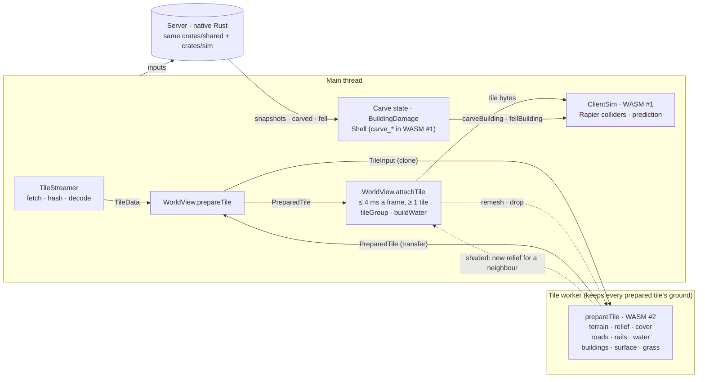
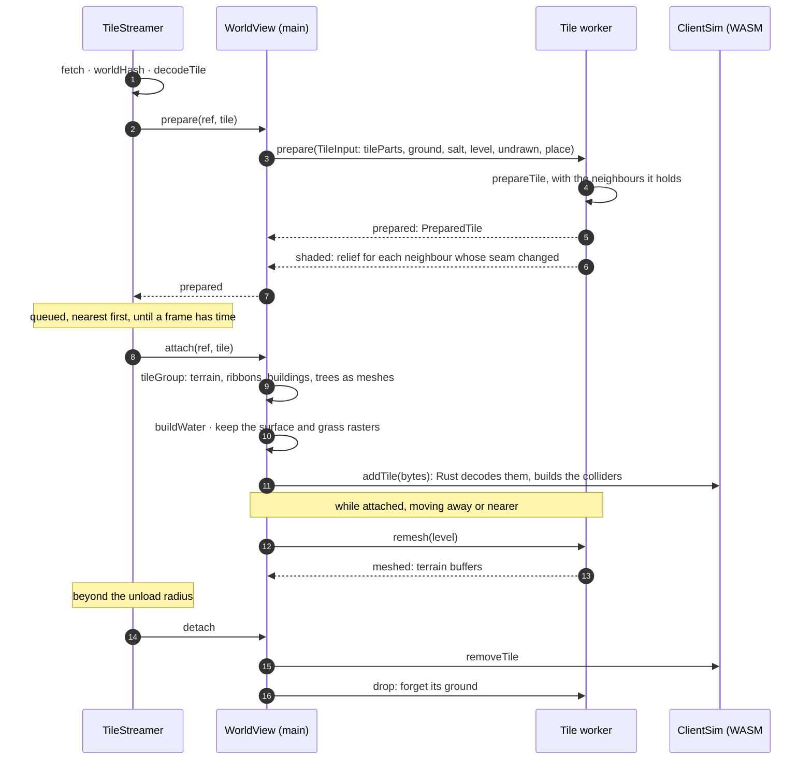
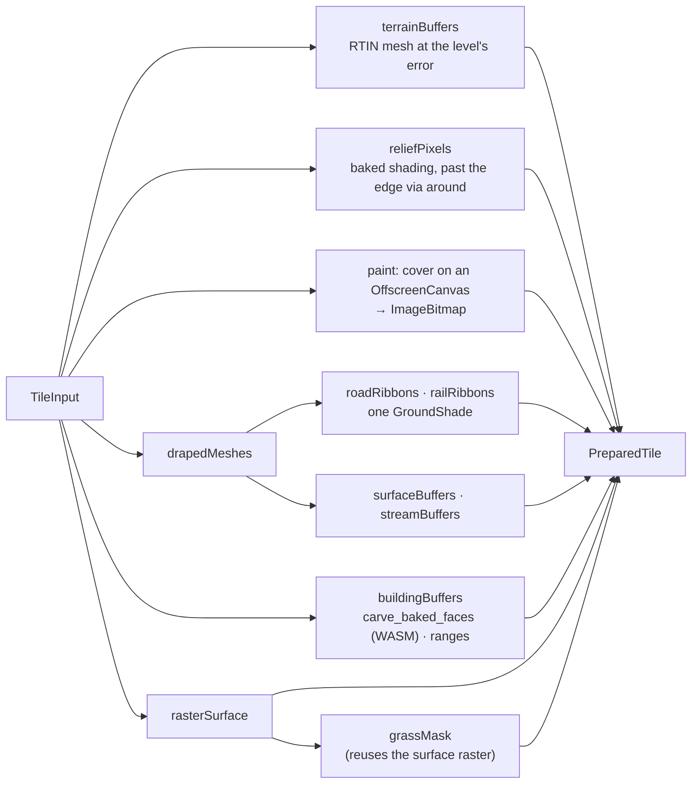
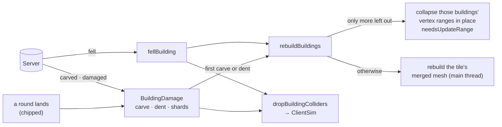

# Tile streaming

How the client brings a tile of the world in and out around the player, and which thread does what. The rule: the main thread only does what has to happen in step with the frame (input, prediction, colliders, the scene, the GPU upload). Everything else a tile turns into is made by one pure function, `prepareTile`, in one Web Worker, and the arrays are transferred back without copying. Rust compiled to WASM is used where the client must compute exactly what the server does.

On the 1 m dev world, attaching a tile costs the main thread about 0.3 ms to wrap its arrays in meshes (p95 1.1 ms), plus about 1.4 ms for its colliders (see [Costs](#costs)).

## Threads



| Thread | Owns | Keeps between tiles | WASM |
|---|---|---|---|
| Main | Streaming, the scene graph and GPU upload, prediction and colliders (`ClientSim`), carve and damage state, surface and grass lookups | Everything that is attached | #1, the whole simulation module, initialised by `SimMotor.create` |
| Tile worker (`render/tile.worker.ts`) | `prepareTile` for every streamed-in tile, and remeshing a tile's terrain at another level of detail | The ground and relief of every tile it prepared, until `drop` | #2, the same module, initialised in the worker and awaited before the first tile with buildings. Only `carve_baked_faces` (and `carve_cut` for a hand-built world) is used |

Without a worker (no `Worker` or `OffscreenCanvas`: tests, Node), or when a request fails, `attachTile` runs the same `prepareTile` on the main thread. There is one fallback, and it is the same code.

## A tile's life



**Streaming** (`stream.ts`):
- **Load and unload:** tiles within 450 m of the player are loaded, and dropped again beyond 550 m, with four fetches at a time.
- **Prepare:** `prepare` runs off the frame and is always awaited before a tile is attached or discarded, so a worker reply never arrives for a tile the view has already dropped.
- **Attach:** the ready queue attaches the nearest tiles first, for up to 4 ms a frame, but always at least one, whatever it costs. That is why everything costly happens in `prepare`.

**Prepare** (`WorldView.prepareTile`) sends the worker a `TileInput`:
- **`tileParts`:** the tile's cover, roads, rails, water, streams, buildings, bridges, collision mesh and detail slopes. The trees and the file's bytes are left out.
- **`ground`:** its ground heights.
- **`salt`:** for the building colours.
- **`level`:** the terrain's level of detail for its distance.
- **`undrawn`:** the buildings to leave out (fallen, or drawn as shards).
- **`place`:** where the tile lies, for the rasters.

The worker answers with a `PreparedTile`, which `WorldView` keeps in `prepared` until the tile attaches.

**Attach** (`WorldView.attachTile`) is the frame's work:
- **Damage check:** if more buildings came down while the tile was being prepared, the buildings alone are rebuilt here (`buildingBuffers`).
- **Meshes:** `tileGroup` wraps the terrain, ribbons and building buffers in meshes with shared materials, and adds the trees. `buildWater` does the same for the water.
- **Lookups:** `Surfaces.add` and `Grass.addTile` keep the prepared rasters for what the main thread asks about the ground under a point.
- **Colliders:** `ClientSim.addTile` decodes the tile's bytes again in Rust and builds its Rapier colliders. It stays on the main thread because the predictor steps the simulation with every input and replays it on correction.
- **Damage first:** buildings that fell, or were hurt, while the tile was away are taken out at once.

**Level of detail.** The terrain is simplified to one of three error levels (`TERRAIN_LOD_ERRORS`, 4, 15 and 50 cm) by distance: up to 150 m, up to 320 m, beyond, with 20 m of hysteresis. When the viewer has moved 8 m, `WorldView.focus` asks the worker to `remesh` tiles whose level changed, from the ground it kept. Ribbons and water are draped on the true ground and are not remeshed.

**Seams.** A tile shaded or draped before its neighbour arrived only saw its own edge. The worker re-sends the relief of every neighbour when a tile arrives (`shaded`). A tile prepared on the main thread is re-stitched there (`restitchTerrain`). Ribbons and water are draped once, with whatever neighbours were there, and not redone.

## What `prepareTile` makes



- **Terrain** (`render/terrainmesh.ts`): `terrainBuffers` at the requested error, and `reliefPixels`, which reads the neighbours' ground through `around`.
- **Cover:** painted by the `paint` the caller passes. The worker paints on an `OffscreenCanvas` and sends an `ImageBitmap`. Without one, the cover is left out and `tileGroup` bakes it on a DOM canvas.
- **Roads and rails** (`render/roads.ts`, `rails.ts`, through `render/groundmesh.ts`): ribbons that share one `GroundShade` (`render/shade.ts`). It caches node heights and normals and a 3 m lattice of ring means for the tile and 16 m past its edge, so a ribbon vertex costs about one height sample instead of fourteen.
- **Water** (`render/watermesh.ts`): the lake and river surface, and stream ribbons.
- **Buildings** (`render/buildingmesh.ts`): each building's faces in one WASM call straight from its packed cells, written into arrays of their final size with the bounds as they go, and each building's vertex range.
- **Rasters:** `rasterSurface` (`sim/surface.ts`) and `grassMask` (`render/grassmask.ts`), which reuses the same raster instead of working it out again.

None of these modules import the engine or touch the DOM. `render/world.ts` turns the result into meshes (`tileGroup`, `ribbonMeshes`, `mergedMesh`), and `render/water.ts` does the water (`buildWater`).

| Message | Direction | Carries | Sent as |
|---|---|---|---|
| `init` | main → worker | world size and tile size | — |
| `prepare` | main → worker | `TileInput` | clone, 0.1 / 0.2 / 0.3 ms |
| `prepared` | worker → main | `PreparedTile`: terrain buffers, relief, cover bitmap, ribbons, water, buildings with ranges, surface and grass cells | transfer |
| `shaded` | worker → main | a neighbour's new relief | transfer |
| `remesh` / `meshed` | both ways | a level / terrain buffers | — / transfer |
| `drop` | main → worker | the tile to forget | — |

The only copies are the input on its way in, which the main thread keeps using, and, in the worker, the relief maps it keeps for seams.

## Damage



All damage is handled on the main thread, from the client's carve state:
- **The carve state:** `goneBuildings`, `BuildingDamage`, and `Shell` in `sim/carve.ts`, which unpacks a building's cells only once something asks after single cells.
- **What the worker knows:** nothing about damage. It only builds a tile as it was when it was prepared.
- **Taking a building out:** when a building falls, or its first dent hands it to the shards, the merged mesh collapses that building's vertices onto one point and re-sends only that range. A full rebuild happens only if a building comes back.

## Costs

The 1 m dev world (`client/public/dev`, 121 tiles of 256 m). Times are in ms per tile: median / p95 / max.

| Stage | Where | Now | Before this work |
|---|---|---|---|
| `tileGroup` + `buildWater` | main (Chrome) | 0.30 / 1.10 / 4.3 | 22.4 / 38.2 / 52.8, everything built on the main thread |
| Posting `prepare` | main (Chrome) | 0.10 / 0.20 / 0.30 | — |
| Hash + decode | main (Chrome) | 0.70 / 1.20 / 1.60 | about 4.5 median (Node) |
| `ClientSim.addTile` | main, WASM (Node) | 1.41 / 3.14 / 5.21 | same |
| A building falling | main (Node) | 0.03 / 0.09 / 0.16 | 0.29 / 7.43 / 11.87 |
| `prepareTile`, the whole tile | worker (Node) | 26.2 / 35.0 / 61.0 | — |
| of which roads + rails | worker (Node) | 5.7 / 13.2 / 20.4 | 24.7 / 55.2 / 101.4, on the main thread |
| of which the terrain mesh, finest level | worker (Node) | 9.0 / 12.1 / 18.6 | same |
| of which buildings | worker (Node) | 1.8 / 10.2 / 15.4 | up to 21 ms on the main thread |
| of which surface raster + grass mask | worker (Node) | about 0.7 / 1.8 / 2.6 | 0.9 / 3.1 / 11.5, on the main thread |

`prepareTile` takes about 26 ms of the worker's time per tile, so one worker keeps up with about 35 tiles a second. Tiles are fetched from 450 m away and arrive a few a second at driving speed, so that is plenty.

**Garbage.** Decoding a tile allocates about 1.1 MB on the main thread's heap and keeps 137 KB of it. The rest is msgpack's temporary arrays, which die young and cost an occasional minor collection. The worker allocates more (about 1.3 MB of shading cache per tile), but its collections never touch the frame.

To measure, from `client/`:

```sh
BENCH=1 npx vitest run tiles.bench --silent=false
```

`src/__tests__/tiles.bench.spec.ts` times every stage, and `prepareTile` as a whole, over the dev world. Every tile's ground is loaded, so ribbons near an edge sample their neighbours as in the game. It skips itself without `BENCH` or the dev world. Node runs V8 as Chrome does, so the numbers are close but not the same: Chrome was faster on hashing and decoding.

## Code map

| File | What |
|---|---|
| `client/src/stream.ts` | `TileStreamer`: what to load and unload, fetches, the ready queue and the attach budget |
| `client/src/world.ts` | `fetchTile`, `worldHash`, `decodeTile` |
| `client/src/worldview.ts` | `prepareTile`, `tileInput`, `attachTile`, `discardTile`, `focus` (level of detail), damage entry points |
| `client/src/render/tileprep.ts` | `prepareTile`, `TileInput`, `PreparedTile`, `tileParts` |
| `client/src/render/tileworker.ts`, `tile.worker.ts` | The tile worker: its messages, its kept grounds, seams and remeshing |
| `client/src/render/terrainmesh.ts` | Terrain mesh, levels of detail, relief, cover painting |
| `client/src/render/groundmesh.ts` | `drapedMeshes`: a tile's roads, rails and water |
| `client/src/render/roads.ts`, `rails.ts`, `watermesh.ts` | Ribbon and water mesh data |
| `client/src/render/shade.ts` | Height sampling, `GroundShade`, tone |
| `client/src/render/buildingmesh.ts` | `buildingBuffers`, building colours |
| `client/src/render/grassmask.ts`, `client/src/sim/surface.ts` | The grass and surface rasters |
| `client/src/render/world.ts` | `tileGroup`, `buildTile` (prepare and wrap at once, for tests), `rebuildBuildings` |
| `client/src/sim/carve.ts` | `Shell`: a building's cells, through WASM |
| `client/src/sim/motor.ts` | `SimMotor` / `ClientSim`: WASM #1 |

## Open

- **Play-test.** Check roads at tile seams, in ditches and on distant tiles (beyond 320 m the terrain is drawn up to 50 cm off the true ground), and water. Record a Chrome trace while driving across the dev world: are any frames over 20 ms, and what are they spent on? Per-frame garbage in the game loop is not measured yet; the trace would show it.
- **Ribbon seams.** Re-drape the ribbons along a shared edge when a neighbour arrives, as the relief is, if roads show a step there.
- **Carve-only WASM for the worker.** The worker loads the whole simulation module (Rapier included) for the carve functions. Its first tile with buildings waits about 46 ms for it, and the module holds memory of its own. Split out a small `carve-wasm` crate only if that shows up in a trace or a memory profile.
- **Ground as raw bytes in the tile file.** Decoding would become a near zero-copy view and drop most of decoding's 1.1 MB of garbage. It is a format change (Rust, a version bump, regenerated worlds) for about 0.3 ms a tile, so it waits.

## Decided against

- **Moving `ClientSim` into a worker.** Every prediction step would be a message away: a frame of input latency and an asynchronous reconcile. `addTile` is 1.4 ms median, which doesn't justify that.
- **A worker per kind of mesh** (as it was: a terrain worker and a buildings worker). It ran a tile's buildings alongside its terrain, but cost two protocols, two prepared maps and a fallback per mesh. The tile worker is one of each. It adds a few milliseconds of latency to preparing a tile, but no frame time.
- **A pool of workers that each prepare whole tiles.** Draping needs the neighbours' ground in one place.
- **Shared WASM memory across threads.** It needs cross-origin isolation headers and WASM threads. That is far more than this calls for.
- **Decoding in the worker.** Hash + decode is 1.2 ms p95 in Chrome, and a worker would cost a clone of `TileData` back.

## History

All on 2026-10-25, on master:

| Commit | Change |
|---|---|
| `b2dc2f5` | A building's faces come straight from its packed cells |
| `f0538a4` | Building meshes are written into arrays of their final size |
| `9e319c7` | A buildings worker |
| `a564a35` | The tile benchmark |
| `a45604b` | `worldHash` uses an indexed loop |
| `614b2a2` | `GroundShade` for road and rail shading |
| `46322e0` | Roads, rails and water move to the terrain worker |
| `97e918b` | `decodeTile` fills its arrays with loops |
| `7ae3cdc` | A fallen building is taken out in place |
| `5456d00` | One tile worker and one `prepareTile` replace the two workers; the surface and grass rasters move off the main thread |
