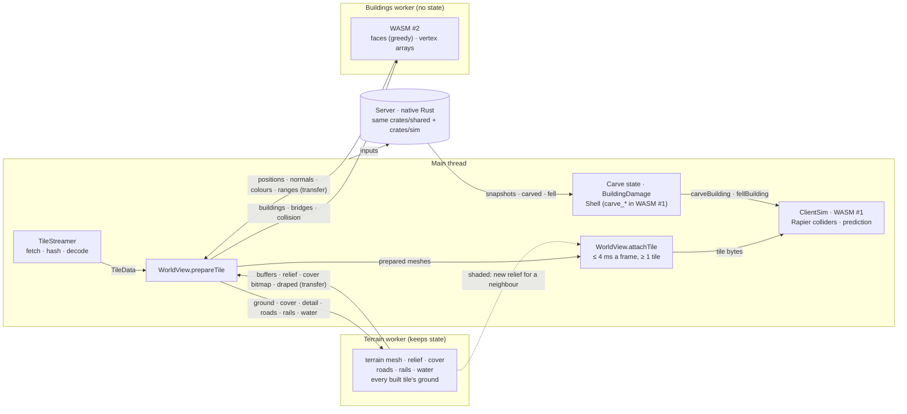
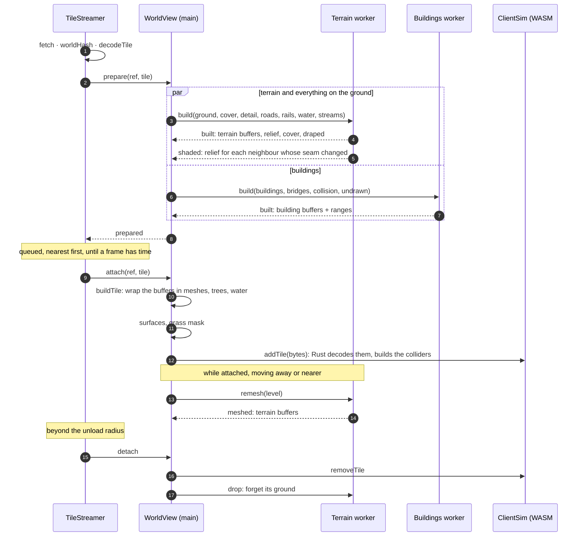
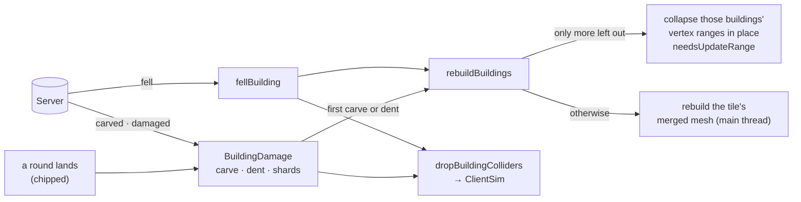

# Tile streaming

How the client brings a tile of the world in and out around the player, and which thread does what. The rule: the main thread only does what has to happen in step with the frame (input, prediction, colliders, the scene, the GPU upload). Turning a tile's data into vertex buffers happens in Web Workers, and the buffers are transferred back without copying. Rust compiled to WASM is used where the client must compute exactly what the server does.

On the 1 m dev world, attaching a tile costs the main thread about 0.3 ms of mesh work (p95 0.7 ms), plus the colliders, grass mask and surface raster (see [Costs](#costs)).

## Threads



| Thread | Owns | Keeps between tiles | WASM |
|---|---|---|---|
| Main | Streaming, the scene graph and GPU upload, prediction and colliders (`ClientSim`), carve and damage state, grass and surface queries | Everything that is attached | #1, the whole simulation module, initialised by `SimMotor.create` |
| Terrain worker (`render/terrain.worker.ts`) | A tile's terrain mesh at a level of detail, relief map, cover texture, and what is draped on its ground: roads, rails, water | The ground of every tile it built, until `drop` | None: all TypeScript |
| Buildings worker (`render/buildings.worker.ts`) | A tile's merged building and bridge mesh | Nothing | #2, the same 2.8 MB module, initialised in the worker. Only `carve_baked_faces` is used |

Both workers fall back to the main thread when there is no `Worker` (tests, Node) or a request fails. The main thread then runs the same functions itself. The terrain worker also needs `OffscreenCanvas`.

## A tile's life



**Streaming** (`stream.ts`):
- **Load and unload:** tiles within 450 m of the player are loaded, and dropped again beyond 550 m, with four fetches at a time.
- **Prepare:** `prepare` runs off the frame and is always awaited before a tile is attached or discarded, so a worker reply never arrives for a tile the view has already dropped.
- **Attach:** the ready queue attaches the nearest tiles first, for up to 4 ms a frame, but always at least one, whatever it costs. That is why everything costly has to happen in `prepare`.

**Prepare** (`WorldView.prepareTile`) sends to both workers at once and keeps what comes back in `prepared` (terrain) and `preparedBuildings`. The buildings are built without the buildings the view leaves out at that moment (`undrawnBuildings`: fallen, or drawn as shards). If that set changes before the tile attaches, the worker's mesh is thrown away and the main thread builds the buildings itself.

**Attach** (`WorldView.attachTile`) is the frame's work:
- **Meshes:** `buildTile` wraps the prepared terrain, ribbons and building buffers in meshes, with shared materials, and adds the trees. `buildWater` does the same for the water.
- **Queries:** `Surfaces.add` and `Grass.addTile` rasterise the tile's cover for what the main thread asks about the ground under a point.
- **Colliders:** `ClientSim.addTile` decodes the tile's bytes again in Rust and builds its Rapier colliders. It stays on the main thread because the predictor steps the simulation with every input and replays it on correction.
- **Damage first:** buildings that fell, or were hurt, while the tile was away are taken out at once.

**Level of detail.** The terrain is simplified to one of three error levels (`TERRAIN_LOD_ERRORS`, 4, 15 and 50 cm) by distance: up to 150 m, up to 320 m, beyond, with 20 m of hysteresis. When the viewer has moved 8 m, `WorldView.focus` asks the worker to `remesh` tiles whose level changed, from the ground it kept. Ribbons and water are draped on the true ground and are not remeshed.

**Seams.** A tile shaded or draped before its neighbour arrived only saw its own edge. The terrain worker re-sends the relief of every neighbour when a tile arrives (`shaded`). A tile the main thread built is re-stitched there (`restitchTerrain`). Ribbons and water are draped once, with whatever neighbours were loaded, and not redone.

## What a worker builds

**Terrain worker**, per `build`:
- **Terrain:** `terrainBuffers`, an RTIN mesh at the requested error, and `reliefPixels`, the baked shading, which reads the neighbours' ground through the worker's `Terrain`.
- **Cover:** `paintCover`, on an `OffscreenCanvas`, sent as an `ImageBitmap`.
- **Draped:** `drapedMeshes` (`render/groundmesh.ts`).
  - Roads and rails: `roadRibbons` and `railRibbons` share one `GroundShade` (`render/shade.ts`), which caches node heights and normals and a 3 m lattice of ring means for the tile and 16 m past its edge. A ribbon vertex then costs about one height sample instead of fourteen.
  - Water: `surfaceBuffers` and `streamBuffers` (`render/watermesh.ts`).

**Buildings worker**, per `build`: `buildingBuffers` (`render/buildingmesh.ts`).
- **Faces:** each building's faces come in one WASM call straight from its packed cells (`carve::whole_faces`).
- **Fill:** positions, normals and colours are written into arrays of their final size, with the bounds as they go.
- **Ranges:** each building's vertex range is recorded, so a building can be taken out of the mesh later in place.

None of the modules the workers load import the engine or touch the DOM. The main thread turns their output into meshes:
- `mergedMesh` and `ribbonMeshes` in `render/world.ts`.
- `buildWater` in `render/water.ts`.

| Message | Direction | Carries | Sent as |
|---|---|---|---|
| `TerrainRequest.build` | main → terrain | ground heights, cover, detail slopes, roads, rails, water levels, streams | clone |
| `TerrainReply.built` | terrain → main | terrain buffers, relief pixels, cover bitmap, ribbons and water buffers | transfer |
| `TerrainReply.shaded` | terrain → main | a neighbour's new relief | transfer |
| `TerrainRequest.remesh` / `meshed` | both ways | a level / terrain buffers | — / transfer |
| `TerrainRequest.drop` | main → terrain | the tile to forget | — |
| `BuildingRequest.build` | main → buildings | buildings (cells, triangle ranges, roof kind), bridges, collision mesh, undrawn set | clone |
| `BuildingReply.built` | buildings → main | positions, normals, colours, bounds, ranges | transfer |

## Damage



All damage is handled on the main thread, from the client's carve state:
- **The carve state:** `goneBuildings`, `BuildingDamage`, and `Shell` in `sim/carve.ts`, which unpacks a building's cells only once something asks after single cells.
- **What the workers know:** nothing about damage. They only ever build a tile as it is when it is prepared.
- **Taking a building out:** when a building falls, or its first dent hands it to the shards, the merged mesh collapses that building's vertices onto one point and re-sends only that range. A full rebuild happens only if a building comes back.

## Costs

The 1 m dev world (`client/public/dev`, 121 tiles of 256 m). Times are in ms per tile: median / p95 / max.

| Stage | Where | Now | Before this work |
|---|---|---|---|
| `buildTile` + `buildWater`, with the workers' results | main (Chrome) | 0.30 / 0.70 / 4.7 | 22.4 / 38.2 / 52.8, all on the main thread |
| Hash + decode | main (Chrome) | 0.70 / 1.20 / 1.60 | about 4.5 median (Node) |
| `ClientSim.addTile` | main, WASM (Node) | 1.33 / 2.78 / 5.44 | same |
| Grass mask | main (Node) | 0.62 / 2.05 / 7.15 | same |
| Surface raster | main (Node) | 0.24 / 1.04 / 4.37 | same |
| A building falling | main (Node) | 0.03 / 0.10 / 0.15 | 0.29 / 7.43 / 11.87 |
| Roads + rails ribbons | terrain worker (Node) | 6.2 / 14.4 / 21.1 | 24.7 / 55.2 / 101.4, on the main thread |
| Terrain mesh, finest level | terrain worker (Node) | 9.6 / 14.6 / 32.4 | same |
| Building mesh | buildings worker (Node) | 2.2 / 10.3 / 15.2 | up to 21 ms on the main thread |

To measure, from `client/`:

```sh
BENCH=1 npx vitest run tiles.bench --silent=false
```

`src/__tests__/tiles.bench.spec.ts` times every stage over the dev world, with every tile's ground loaded, so ribbons near an edge sample their neighbours as in the game. It skips itself without `BENCH` or the dev world. Node runs V8 as Chrome does, so the numbers are close but not the same: Chrome was faster on hashing and decoding.

## Code map

| File | What |
|---|---|
| `client/src/stream.ts` | `TileStreamer`: what to load and unload, fetches, the ready queue and the attach budget |
| `client/src/world.ts` | `fetchTile`, `worldHash`, `decodeTile` |
| `client/src/worldview.ts` | `prepareTile`, `attachTile`, `discardTile`, `focus` (level of detail), damage entry points |
| `client/src/render/terrainworker.ts`, `terrain.worker.ts` | The terrain worker and its messages |
| `client/src/render/buildingworker.ts`, `buildings.worker.ts` | The buildings worker and its messages |
| `client/src/render/terrainmesh.ts` | Terrain mesh, levels of detail, relief, cover painting |
| `client/src/render/groundmesh.ts` | `drapedMeshes`: a tile's roads, rails and water |
| `client/src/render/roads.ts`, `rails.ts`, `watermesh.ts` | Ribbon and water mesh data |
| `client/src/render/shade.ts` | Height sampling, `GroundShade`, tone |
| `client/src/render/buildingmesh.ts` | `buildingBuffers`, building colours |
| `client/src/render/world.ts` | `buildTile`, `rebuildBuildings`, turning buffers into meshes |
| `client/src/sim/carve.ts` | `Shell`: a building's cells, through WASM |
| `client/src/sim/motor.ts` | `SimMotor` / `ClientSim`: WASM #1 |

## Open

- **Play-test.** Check roads at tile seams, in ditches and on distant tiles (beyond 320 m the terrain is drawn up to 50 cm off the true ground), and water. Record a Chrome trace while driving across the dev world: are any frames over 20 ms, and what are they spent on?
- **If attaching still shows in a trace,** the grass mask and surface raster are next. They only read the tile's cover, roads and water, so the terrain worker could rasterise them too.
- **Ribbon seams.** Re-drape the ribbons along a shared edge when a neighbour arrives, as the relief is, if roads show a step there.
- **Carve-only WASM for the buildings worker.** The worker loads the whole simulation module (Rapier included) for one function. Its first request takes about 46 ms, and the module holds memory of its own. Split out a small `carve-wasm` crate only if that shows up in a trace or a memory profile.

## Decided against

- **Moving `ClientSim` into a worker.** Every prediction step would be a message away: a frame of input latency and an asynchronous reconcile. `addTile` is 1.3 ms median, which doesn't justify that.
- **A pool of workers that each build whole tiles.** Draping needs the neighbours' ground in one place.
- **Shared WASM memory across threads.** It needs cross-origin isolation headers and WASM threads. That is far more than this calls for.
- **Decoding in a worker.** Hash + decode is 1.2 ms p95 in Chrome, and a worker would cost a clone of `TileData` back.

## History

All on 2026-10-25, on master:

| Commit | Change |
|---|---|
| `b2dc2f5` | A building's faces come straight from its packed cells |
| `f0538a4` | Building meshes are written into arrays of their final size |
| `9e319c7` | The buildings worker |
| `a564a35` | The tile benchmark |
| `a45604b` | `worldHash` uses an indexed loop |
| `614b2a2` | `GroundShade` for road and rail shading |
| `46322e0` | Roads, rails and water move to the terrain worker |
| `97e918b` | `decodeTile` fills its arrays with loops |
| `7ae3cdc` | A fallen building is taken out in place |
